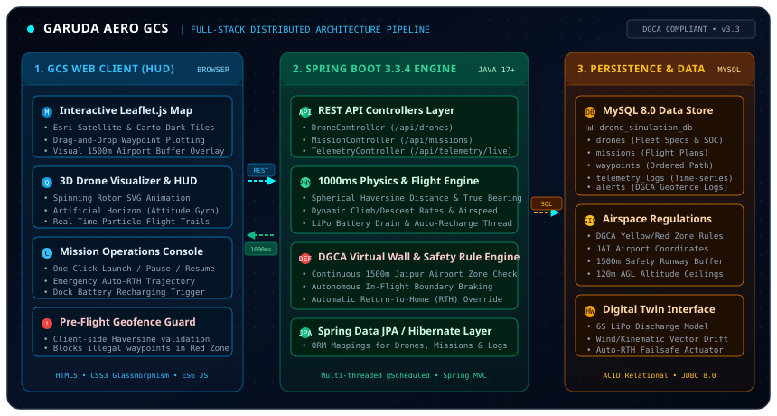

<div align="center">

# 🚁 Garuda Aero GCS — Autonomous Drone Mission Planning & Airspace Safety Platform

[](https://www.oracle.com/java/)
[](https://spring.io/projects/spring-boot)
[](https://www.mysql.com/)
[](https://leafletjs.com/)
[](https://opensource.org/licenses/MIT)

<br><br>



<br>

*An enterprise-grade Ground Control Station (GCS) and real-time Digital Twin flight simulator featuring dynamic waypoint path generation, dual-layer active airspace geofencing (DGCA compliance), physics telemetry simulation, and an interactive 3D web dashboard.*

</div>

---

## 📌 Project Overview

**Garuda Aero GCS** is a distributed, full-stack aerospace flight control and mission planning platform engineered to solve real-world airspace compliance and autonomous navigation challenges for Unmanned Aerial Vehicles (UAVs). 

With the rapid expansion of commercial drone operations across India, airspace safety under **Directorate General of Civil Aviation (DGCA)** regulations has become paramount. Garuda Aero GCS provides an autonomous safety barrier that continuously guards against restricted no-fly zone incursions—specifically safeguarding the approach corridors of **Jaipur International Airport (JAI sector)** through a high-frequency **Virtual Wall & Auto-RTH Failsafe Engine**.

The system pairs a high-frequency **Spring Boot 3.3.4 (Java 17)** simulation engine with a glassmorphism **Ground Control Station (GCS) HUD** built with Leaflet.js, Esri World Imagery, and reactive REST telemetry streams.

---

## ✨ Key Highlights & Features

- 🗺️ **Interactive Waypoint Flight Planner:** Drag-and-drop / click-to-plot GPS flight paths directly on high-resolution satellite imagery (Esri World Imagery) and street cartography.
- 🛡️ **Dual-Layer Active Geofencing & Virtual Wall (DGCA Compliance):**
  - **Level 1 (Pre-Flight Planner Guard):** Instant client-side Haversine validation that prevents plotting waypoints inside restricted airport no-fly zones (*Jaipur International Airport - JAI 1500m buffer*).
  - **Level 2 (In-Flight Autonomous Virtual Wall):** Real-time server-side collision avoidance that actively brakes the drone at restricted perimeters and engages automatic **Return-To-Home (RTH)** trajectory override.
- ⚡ **Real-Time Physics & Telemetry Engine (1000ms Ticker):** Continuous spherical Haversine distance interpolation, ground speed dynamics, climb/descent rates, true bearing calculation, synthetic 3D attitude (pitch/roll), and multi-variable 6S LiPo battery discharge modeling.
- 🛸 **Animated 3D Quadcopter Visualizer:** Custom SVG drone avatar featuring active spinning rotor discs, pulsing beacon LEDs, directional radar heading cones, and live particle flight trails.
- 📊 **Aerospace Ground Control HUD:** Dark-theme glassmorphism operations dashboard with digital airspeed gauges, altitude meters, heading compasses, and real-time safety alert feeds.
- 💾 **Relational MySQL Persistence:** Full JPA/Hibernate data layer recording drone fleet states, compiled missions, waypoints, and time-series telemetry logs.

---

## 🏛️ System Architecture

<div align="center">
  
</div>

The platform follows a clean, decoupled 3-tier enterprise architecture:
1. **GCS Web Client (HUD):** Responsive browser dashboard providing map rendering, 3D drone animation, mission planning, and 1000ms polling for live telemetry.
2. **Spring Boot 3.3.4 Engine:** Multi-threaded backend handling REST controllers, task scheduling (`@Scheduled`), spherical trigonometry physics calculation, and the DGCA safety rule engine.
3. **Data Persistence & Airspace Data:** MySQL 8.0 relational database persisting fleet profiles, mission waypoints, time-series telemetry logs, and airspace violation alerts.

---

## 🛡️ DGCA Airspace Compliance & Geofencing Rules

Garuda Aero GCS models the regulatory airspace framework defined by the **Ministry of Civil Aviation (MoCA) & DGCA India**:

| Airspace Zone | Definition in Garuda GCS | System Action |
| :--- | :--- | :--- |
| **🔴 Red Zone (Prohibited)** | 1500m radial buffer centered on **Jaipur International Airport Runway (26.8286° N, 75.8056° E)** | **Zero Tolerance:** Waypoint placement rejected. In-flight entry triggers instantaneous Virtual Wall brake and forces autonomous Return-To-Home (RTH). |
| **🟡 Yellow Zone (Controlled)** | 6000m perimeter around operational aerodrome | Warning advisory logged; altitude strictly capped at **120 meters (400 ft) AGL**. |
| **🟢 Green Zone (Permitted)** | Unrestricted airspace outside airport buffer corridors | Free flight permitted up to maximum legal ceiling with active battery health monitoring. |

---

## 🛠️ Technology Stack

<div align="center">

| Layer | Technologies | Description |
| :--- | :--- | :--- |
| **Backend Core** | Java 17+, Spring Boot 3.3.4, Spring Web | Enterprise application framework & REST API controllers |
| **Persistence & ORM** | Spring Data JPA, Hibernate 6.5, MySQL 8.0, HikariCP | Relational data persistence, connection pooling & transactional consistency |
| **Simulation Engine** | Spring `@Scheduled` Task Scheduler | 1000ms high-frequency physics loop, kinematics, & battery drain simulation |
| **Geospatial Math** | Spherical Trigonometry (Haversine & Azimuth Bearing) | Great-circle distance interpolation & directional bearing calculations |
| **Frontend HUD** | HTML5, Modern CSS3, JavaScript (ES6+), FontAwesome 6 | Glassmorphism dark aerospace operations dashboard |
| **Cartography** | Leaflet.js 1.9.4, Esri World Imagery, CartoDB Dark | High-resolution satellite tiles, vector polygons & waypoint polylines |
| **Build & Tooling** | Apache Maven, Git & GitHub | Dependency management, build automation & version control |

</div>

---

## 📂 Project Directory Structure

```text
garuda-aero-gcs/
├── assets/
│   ├── garuda-preview.svg                       # GCS Telemetry HUD preview graphic
│   └── architecture.svg                         # Distributed system architecture diagram
├── pom.xml                                      # Maven dependencies & build definitions
├── src/
│   └── main/
│       ├── java/com/drone/simulation/
│       │   ├── DroneSimulationApplication.java  # Spring Boot Main Entry Point
│       │   │
│       │   ├── controller/                      # REST API Endpoints
│       │   │   ├── DroneController.java         # /api/drones (Fleet management)
│       │   │   ├── MissionController.java       # /api/missions (Flight plans)
│       │   │   ├── TelemetryController.java     # /api/telemetry (Live telemetry feed)
│       │   │   ├── FlightAlertController.java   # /api/alerts (Safety violations)
│       │   │   └── DashboardController.java     # /api/dashboard (Aggregated stats)
│       │   │
│       │   ├── model/                           # JPA Entities & Domain Models
│       │   │   ├── Drone.java                   # Fleet registry & physical specs
│       │   │   ├── Mission.java                 # Flight plans & lifecycle states
│       │   │   ├── Waypoint.java                # Sequence GPS coordinates & altitudes
│       │   │   ├── TelemetryLog.java            # Time-series blackbox flight logs
│       │   │   ├── FlightAlert.java             # Safety rule violation incident logs
│       │   │   └── DroneStatus.java             # Enums: IDLE, IN_FLIGHT, RTH, etc.
│       │   │
│       │   ├── repository/                      # Spring Data JPA Repositories
│       │   │   ├── DroneRepository.java
│       │   │   ├── MissionRepository.java
│       │   │   ├── WaypointRepository.java
│       │   │   ├── TelemetryLogRepository.java
│       │   │   └── FlightAlertRepository.java
│       │   │
│       │   ├── service/                         # Core Business Logic & Simulation
│       │   │   ├── TelemetrySimulatorService.java # 1-sec physics engine & coordinate math
│       │   │   ├── AlertRuleEngineService.java    # Hard virtual wall & safety triggers
│       │   │   ├── DroneService.java              # Fleet operations & battery recharge
│       │   │   └── MissionService.java            # Mission planning & lifecycle management
│       │   │
│       │   └── dto/                             # Data Transfer Objects
│       │       ├── MissionCreateRequest.java
│       │       ├── WaypointDto.java
│       │       ├── DroneTelemetryResponse.java
│       │       └── DashboardStatsDto.java
│       │
│       └── resources/
│           ├── application.properties           # MySQL database & server configurations
│           └── static/                          # Web Ground Control Station Frontend
│               ├── index.html                   # GCS Dashboard UI
│               ├── css/style.css                # Modern aerospace dark styling
│               └── js/app.js                    # Map engine, 3D drone visuals & polling
├── LICENSE                                      # MIT License
└── README.md                                    # Comprehensive project documentation
```

---

## ⚡ Setup & Local Execution

### 1. Prerequisites
Ensure you have the following installed on your development workstation:
- **Java Development Kit (JDK 17+)** (Oracle JDK or Eclipse Temurin)
- **Apache Maven 3.8+** (Optional if using IDE bundled Maven)
- **MySQL Community Server 8.0+**
- **IntelliJ IDEA** (Community or Ultimate) / VS Code / Eclipse

### 2. Database Initialization
Launch **MySQL Workbench** or run from your terminal:
```sql
CREATE DATABASE drone_simulation_db;
```

### 3. Application Configuration
Verify or edit `src/main/resources/application.properties` with your local MySQL credentials:
```properties
spring.datasource.url=jdbc:mysql://localhost:3306/drone_simulation_db?createDatabaseIfNotExist=true&useSSL=false&allowPublicKeyRetrieval=true&serverTimezone=UTC
spring.datasource.username=root
spring.datasource.password=YOUR_MYSQL_PASSWORD

# Auto DDL update
spring.jpa.hibernate.ddl-auto=update
spring.jpa.show-sql=false
```

### 4. Running the Application

#### Option A: Using Maven CLI
```bash
# Clone the repository
git clone https://github.com/Atulkumar5772/Garuda-Aero-GCS.git
cd Garuda-Aero-GCS

# Compile & run Spring Boot
mvn clean spring-boot:run
```

#### Option B: Using IntelliJ IDEA
1. Open IntelliJ IDEA ➔ **File ➔ Open** ➔ select the `Garuda-Aero-GCS` directory.
2. Wait for Maven to import dependencies from `pom.xml`.
3. Locate `src/main/java/com/drone/simulation/DroneSimulationApplication.java`.
4. Right-click and select **Run 'DroneSimulationApplication'**.

### 5. Accessing the Ground Control Station
Open your browser and navigate to:
```text
http://localhost:8080
```

---

## 🎮 First Flight Walkthrough

1. **Fleet Selection:** On the left sidebar, select a registered drone (e.g., *Garuda Quad-Alpha*). Verify battery state and specifications.
2. **Waypoint Planning:** Click **"Plan Mission"** on the operations panel.
3. **Plotting Route:** Click anywhere on the map in the permitted green corridor to drop waypoints. Try clicking inside the red circle around Jaipur Airport to observe the **DGCA Geofence Pre-Flight Validator** reject the waypoint.
4. **Mission Compilation:** Name your flight mission and click **"Save & Compile Mission"**.
5. **Takeoff & Live Telemetry:** Click **"Launch Mission"**. Watch the 3D quadcopter rotate towards the target azimuth bearing, spin its rotors, and report real-time altitude, ground speed, and battery consumption every 1000ms.
6. **Failsafe Testing:** Trigger **"RTH (Return to Home)"** at any point to observe the drone autonomously reverse course back to takeoff coordinates.

---

## 📡 REST API Reference

| Method | Endpoint | Description |
| :--- | :--- | :--- |
| `GET` | `/api/drones` | Fetch all registered drones in the fleet |
| `POST` | `/api/drones` | Register a new drone with custom speed/altitude specs |
| `POST` | `/api/drones/{id}/recharge` | Initiate fast dock battery recharge to 100% |
| `GET` | `/api/missions` | List all planned & historical flight missions |
| `POST` | `/api/missions` | Validate, compile, and persist a new mission with waypoints |
| `POST` | `/api/missions/{id}/start` | Launch real-time flight simulation for a mission |
| `POST` | `/api/missions/{id}/pause` | Pause flight in mid-air (Hover mode) |
| `POST` | `/api/missions/{id}/resume` | Resume autonomous flight towards current waypoint |
| `POST` | `/api/missions/{id}/rth` | Trigger manual Return-To-Home (RTH) failsafe |
| `POST` | `/api/missions/{id}/abort` | Emergency abort mission and disarm drone |
| `GET` | `/api/telemetry/live` | Stream real-time GPS, altitude, speed, attitude & battery data |
| `GET` | `/api/alerts` | Retrieve active safety & airspace violation alerts |
| `POST` | `/api/alerts/acknowledge-all` | Clear and acknowledge active alert feed |

---

## 🎯 Engineering & Learning Outcomes

Developing Garuda Aero GCS provided in-depth engineering experience in:
- **Enterprise Spring Boot 3 Architecture:** Designing modular, production-ready micro-services with separation of concerns across Controllers, Services, Repositories, and DTOs.
- **High-Frequency Scheduled Tasks:** Managing real-time multithreaded simulation loops using Spring `@Scheduled` at 1000ms fixed-rate intervals without blocking REST request threads.
- **Geospatial Spherical Trigonometry:** Implementing mathematical formulas from scratch in Java:
  - **Haversine Formula:** Calculating great-circle arc distances over Earth's curved ellipsoidal surface.
  - **Forward Azimuth Bearing:** Calculating continuous dynamic heading angles ($0^\circ - 360^\circ$) between coordinates.
- **Relational Data Modeling & ORM:** Managing complex `@OneToMany` entity relationships between Drones, Missions, and Waypoints with cascading operations.
- **Airspace Safety & DGCA Compliance:** Translating Indian civil aviation regulations into algorithmic boundary checks and autonomous fail-safe triggers.

---

## 🔮 Future Roadmap

- [ ] **MAVLink v2 Protocol Integration:** Direct serial/UDP telemetry bridge for physical ArduPilot & PX4 hardware flight controllers.
- [ ] **CesiumJS 3D Photogrammetry Globe:** Upgrading map viewport to 3D digital elevation models (DEM) for terrain collision detection.
- [ ] **Dynamic AI Obstacle Avoidance:** Real-time path re-planning around moving airspace obstacles using A* / Dijkstra pathfinding.
- [ ] **Multi-UAV Swarm Coordination:** Fleet-wide collision avoidance meshes for concurrent multi-drone delivery operations.

---

## 📄 License

This project is licensed under the **MIT License**. See the [LICENSE](LICENSE) file for complete details.

---

## 👨‍💻 Author

<div align="center">

### Atul Kumar
**Computer Science Student @ PIET Jaipur (2024–2028) • Red Hat Intern • Salesforce Developer**

<p align="center">
  <a href="https://github.com/Atulkumar5772" target="_blank">
    
  </a>
  &nbsp;
  <a href="https://www.linkedin.com/in/atul-kumar-454b34380/" target="_blank">
    
  </a>
</p>

</div>
